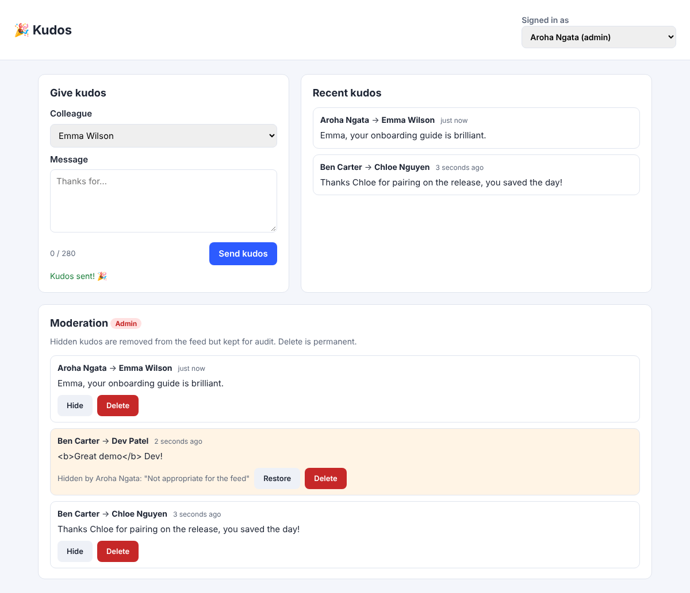
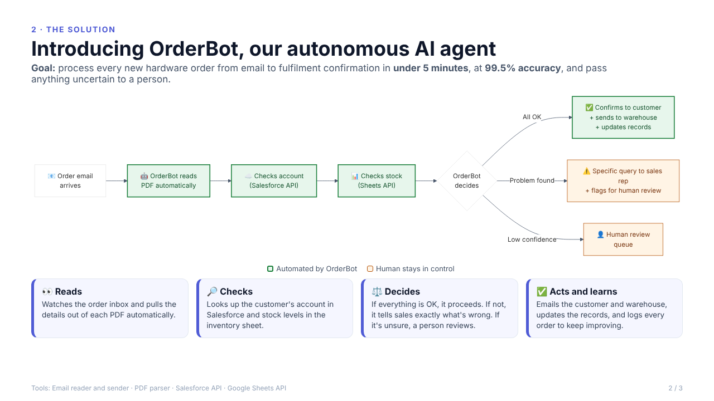

# Datacom: Automation AI Accelerator (From Co-pilot to Autonomous Agent)

**Platform:** [Forage](https://www.theforage.com/) · **Completed:** November 2026 · **Role:** Graduate Developer

**Stack:**


This simulation is about working **with** AI as a developer: first as a **co-pilot** (debugging legacy code), then as an **AI architect** (writing and refining a specification that an AI agent implements), and finally as a **designer of autonomous agents** for business processes. The skill being tested is judgement: giving AI the right context, treating its output as a hypothesis, and verifying everything with tests.

| Task | What I delivered | Folder |
| --- | --- | --- |
| 1. AI-powered debugging and refactoring | Diagnosed a failing nightly data job, reproduced **6 bugs** with failing tests, and refactored it to be robust and much faster | [`task-1-debugging/`](task-1-debugging/) |
| 2. Spec-driven development | Turned "we need a way to give kudos" into an approved spec with **moderation added in review**, then a working, tested Kudos feature | [`task-2-kudos/`](task-2-kudos/) |
| 3. Designing an autonomous agent | Mapped a manual order process and designed **OrderBot**, an AI agent with human-in-the-loop safeguards, presented in a 3-slide management deck | [`task-3-orderbot/`](task-3-orderbot/) |

---

## Task 1: AI-powered debugging and refactoring

**Scenario:** the client's nightly `process_data.py` fails intermittently and misses its SLA. The original developer has left.

**What I found:** six real defects, each proven by a test that fails on the legacy script.

| # | Defect | Impact |
| --- | --- | --- |
| 1 | `main()` ignores failed steps and logs "completed successfully" | The failure in `error.log` was hidden, so it looked intermittent |
| 2 | CSV export takes its columns from the first record | Crashes whenever records differ in shape |
| 3 | An empty export writes no header | Downstream imports break |
| 4 | One malformed amount aborts the whole batch | The nightly run fails because of a single bad row |
| 5 | No whitespace cleaning | Datacom's own file split `"books"` and `"books "` into two categories |
| 6 | Money summed as float | 0.10 + 0.20 = 0.30000000000000004 |

**Results:**

```text
TARGET=process_data python -m unittest TEST_CASES   →  FAILED (failures=6)   # legacy
python -m unittest TEST_CASES                       →  Ran 12 tests ... OK   # refactored
```

Benchmark: 20,000 customers and 500,000 transactions.

| Operation | Legacy | Refactored |
| --- | --- | --- |
| Load + process (now validated) | 1.47s | 1.45s |
| 200 searches | 0.72s | **0.21s** (~3.4×) |
| Metrics | 0.178s | **0.005s** (~35×) |

**Files:**

- [`process_data.py`](task-1-debugging/process_data.py): the legacy script
- [`process_data_final.py`](task-1-debugging/process_data_final.py): the fixed and refactored version
- [`TEST_CASES.py`](task-1-debugging/TEST_CASES.py): the 12 tests
- [`DEBUG_LOG.md`](task-1-debugging/DEBUG_LOG.md): every prompt, the AI's answers and my reasoning, including where I **pushed back** on an AI refactor that was slower than the original

---

## Task 2: Spec-driven development (Kudos)

**Brief:** "We need a way for people to give kudos to each other."

**My role as architect:** the AI's first spec had no content moderation. Before approving it, I added:

- **US-4:** administrators can hide or delete inappropriate kudos
- **`is_visible` (boolean, default true)** on the Kudos table, plus `moderated_by`, `moderated_at` and `moderation_reason` for an audit trail
- security requirements: the sender comes from the session, never the request body; SQL is parameterised; output is escaped; admin checks run on the server



*An admin view: Ben's kudos containing HTML is safely escaped and hidden with a reason, and it stays in the moderation list for audit.*

**What was built:**

- a Flask REST API
- a SQLite schema with `CHECK` constraints (no self-kudos, 1 to 280 characters) and a feed index
- an accessible dashboard with a live character counter
- a moderation panel
- **20 pytest tests**, mapped to every acceptance criterion

See [`task-2-kudos/SPECIFICATION.md`](task-2-kudos/SPECIFICATION.md) for the approved requirements and design.

```bash
cd task-2-kudos
pip install -r requirements.txt
python app.py          # http://localhost:5000, switch users at the top right
pytest -v              # 20 passed
```

---

## Task 3: OrderBot (designing an autonomous agent)

**Brief:** the Operations team handles every hardware order by hand: read the PDF, check Salesforce, check a Google Sheet, then write two emails, or email sales back when there's a problem.

**My design:** **OrderBot** reads the order email and PDF, checks the account and stock through APIs, and then decides:

- **confirm:** emails the customer and warehouse and updates the records
- **query:** sends sales a *specific* problem
- **escalate:** sends low-confidence orders to a human

It logs every outcome so it can learn patterns over time. I recommended a **4-week read-only Proof of Concept** before switching on any actions.



📄 [Full 3-slide presentation (PDF)](task-3-orderbot/OrderBot_Proposal.pdf) · [Agent design](task-3-orderbot/README.md)

---

## What I learned

- **Context beats commands.** Prompts with the code, logs and a clear goal got precise answers.
- **AI output is a hypothesis.** I verified the AI's diagnosis, measured its refactor (and rejected the first, slower version), and caught the missing moderation in its spec.
- **Agents need guardrails.** Autonomy works best with confidence thresholds, a human review queue, audit logs and a read-only trial first.
- **The highest-value work happens before the code.** Fixing a requirement costs one line in a spec, but much more once it's in production.

<sub>Brief, legacy script and data were provided by Datacom for the Forage simulation. The AI co-pilot used was Claude (Anthropic).</sub>
