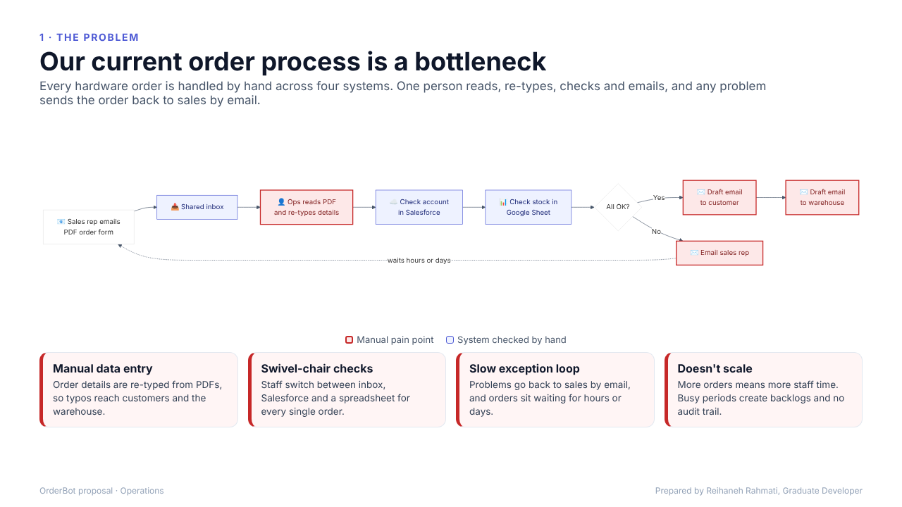
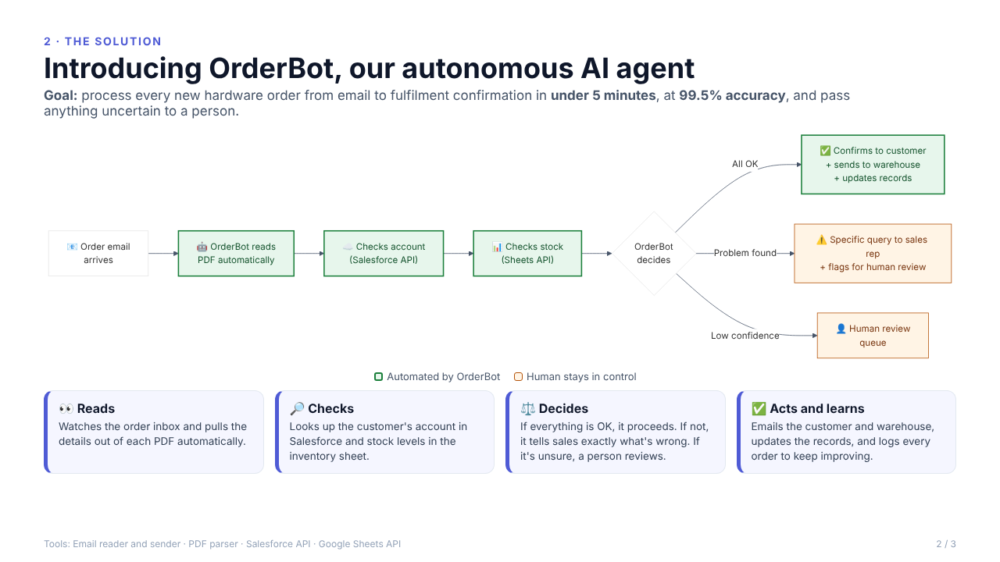
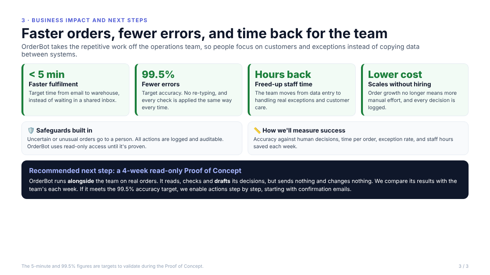

# Task 3: OrderBot, an autonomous AI agent for hardware orders

**Brief:** the Head of Operations is overwhelmed by a manual hardware order process (email, PDF, Salesforce, Google Sheets, and two hand-written emails). I mapped the current process, designed an AI agent to automate it, and presented it to management in 3 slides.

📄 **Presentation:** [`OrderBot_Proposal.pdf`](OrderBot_Proposal.pdf)

| Slide 1: The problem | Slide 2: The solution | Slide 3: Impact and next steps |
| --- | --- | --- |
|  |  |  |

## Agent design: anatomy of OrderBot

| Component | Design |
| --- | --- |
| **Goal** | Process every new hardware order from email receipt to fulfilment confirmation in **under 5 minutes** at **99.5% accuracy**, and send anything uncertain to a person. |
| **Perception (tools)** | Email reader (inbox API) · PDF parser (structured extraction) · Salesforce API (account status) · Google Sheets API (stock levels) |
| **Planning** | 1. Detect the new email → 2. Parse the PDF → 3. Query Salesforce → 4. Query inventory → 5. Decide: success, exception or low confidence → 6. Execute the plan |
| **Decisions** | **All OK:** confirm the order. **Problem found** (account on hold, not enough stock, missing fields): send the sales rep a *specific* query. **Low confidence** (unclear PDF, unusual order): send it to the human review queue. |
| **Action (tools)** | Email sender (customer confirmation, warehouse fulfilment, sales queries) · Salesforce API (update order history) · Sheets API (reduce stock) |
| **Memory / learning** | Logs every order and outcome. Learns patterns, such as reps who often submit incomplete forms or products that often run low, and flags them early. |
| **Safeguards** | Human in the loop for exceptions · full audit log · read-only access during the Proof of Concept · actions switched on one step at a time |

## Bottlenecks in the current process

1. **Manual data entry:** re-typing PDFs causes errors that reach customers and the warehouse.
2. **Swivel-chair checks:** three systems are checked by hand for every order.
3. **Slow exception loop:** problems go back to sales by email, causing delays of hours or days.
4. **No scale or audit trail:** more orders means more staff time, with no record of decisions.

## Recommended next step

A **4-week read-only Proof of Concept**. OrderBot processes real orders alongside the team and *drafts* its decisions without sending or changing anything. Its results are compared with the team's each week, and actions are switched on step by step once it meets the 99.5% accuracy target.

Flowchart sources (Mermaid): [`current.mmd`](current.mmd) · [`orderbot.mmd`](orderbot.mmd)
