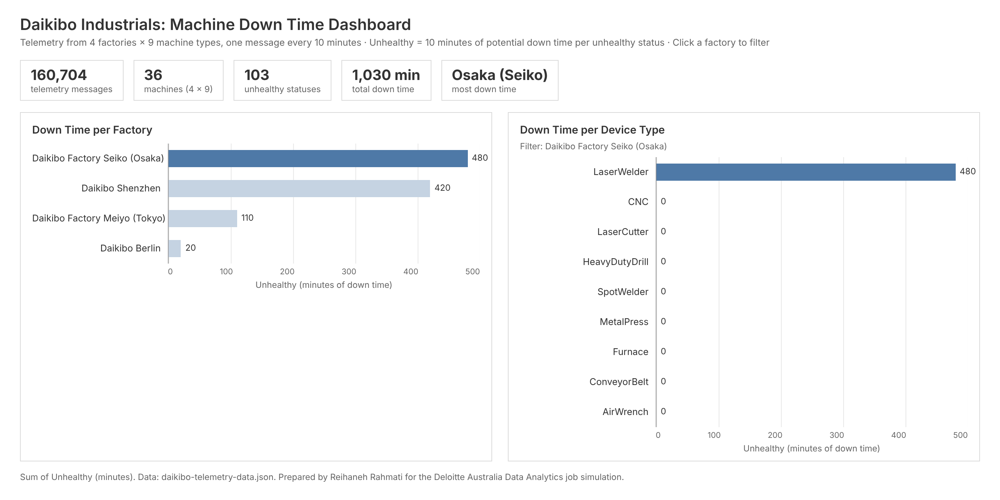

# Deloitte Australia: Data Analytics Job Simulation

**Platform:** [Forage](https://www.theforage.com/) · **Completed:** November 2026 · **Level:** Intermediate (2 tasks)

**Stack:**


As part of Deloitte's Data Analytics and Forensic Technology team, I supported an investigation for **Daikibo Industrials**, a manufacturer with four factories in Japan, Germany and China. The work had two parts:

1. **Operations:** analyse a month of machine telemetry to find **where machines break down most, and which machines are to blame**.
2. **Forensics:** classify pay equality scores to show **where employees are being paid unfairly**.

---

## Task 1: Data analysis (machine down time dashboard)

### The data

Daikibo's tech team merged telemetry from **4 factories × 9 machine types** into one JSON file. Each machine sends a status (`healthy` or `unhealthy`) every 10 minutes.

| Metric | Value |
| --- | --- |
| Telemetry messages | **160,704** |
| Machines | **36** (9 per factory) |
| Unhealthy statuses | **103** |
| Total potential down time | **1,030 minutes** |

### Method

- Created an **"Unhealthy" measure**: each unhealthy status counts as **10 minutes** of potential down time since the previous message.
- Built two bar charts, **Down Time per Factory** and **Down Time per Device Type**.
- Combined them into a dashboard where **the factory chart filters the device chart**: click a factory to see only its machines.

### Dashboard



*Seiko selected: the device chart is filtered to Seiko's machines.* View all factories: [`dashboard_all.png`](task-1-data-analysis/dashboard_all.png) · Interactive version: [`dashboard.html`](task-1-data-analysis/dashboard.html) (download it and open it in a browser, then click a factory).

### Findings

| Rank | Factory | Location | Down time (min) | Main cause |
| --- | --- | --- | --- | --- |
| 1 | **Daikibo Factory Seiko** | Osaka, Japan | **480** | LaserWelder (all 480 minutes) |
| 2 | Daikibo Shenzhen | Shenzhen, China | 420 | LaserCutter (390) |
| 3 | Daikibo Factory Meiyo | Tokyo, Japan | 110 | HeavyDutyDrill (70), LaserCutter (40) |
| 4 | Daikibo Berlin | Berlin, Germany | 20 | Furnace (20) |

**Answers to the client's two questions:**

1. **Where did machines break the most?** Daikibo **Factory Seiko in Osaka**, with 480 minutes of down time, about 47% of the company total.
2. **Which machines broke most there?** The **LaserWelder** caused all of Seiko's down time. It's a **single machine** that went unhealthy **48 times**.

**Recommendation:** Seiko's problem is one machine, not the whole factory. Inspecting or replacing that LaserWelder would remove nearly half of Daikibo's down time. Shenzhen's LaserCutter (390 minutes) should be looked at next.

The numbers can be reproduced with [`analysis.js`](task-1-data-analysis/analysis.js): `node analysis.js daikibo-telemetry-data.json`.

---

## Task 2: Forensic technology (pay equality investigation)

### The task

Deloitte's team processed Daikibo's compensation data into an **Equality Score** for each factory and job role. The score runs from −100 to +100, and 0 is ideal. I added an **Equality class** column:

| Class | Rule | Count |
| --- | --- | --- |
| 🟢 **Fair** | score from −10 to +10 | **19** |
| 🟡 **Unfair** | 10 < \|score\| ≤ 20 | **11** |
| 🔴 **Highly Discriminative** | \|score\| > 20 | **7** |

### Implementation

A single Excel formula, so the class updates automatically if any score changes:

```excel
=IF(ABS(C2)<=10,"Fair",IF(ABS(C2)<=20,"Unfair","Highly Discriminative"))
```

Other touches:

- Conditional formatting colours each class green, yellow or red.
- The header row stays in place when you scroll.
- The table has filters, so reviewers can isolate one class.
- I checked all 37 rows against the rules.

File: [`equality-table.xlsx`](task-2-forensic-technology/equality-table.xlsx)

**A note on the brief:** one of the examples given ("−9 → Unfair") contradicts the stated rule (±10 is Fair). I followed the written rule, so −9 is classed as **Fair**. In a real investigation I would confirm this with the team lead before reporting.

### Findings

- **All 7 "Highly Discriminative" roles are management or support roles:**
  - Meiyo: C-Level −25, VP −26, Operational Support −22
  - Seiko: Sr. Manager −21, Manager −21, Jr. Manager −24
  - Shenzhen: Sr. Manager −21
- **Engineers and Machine Operators are Fair in every factory.**
- **Every non-Fair score is negative**, so the affected groups are consistently **underpaid**, never overpaid.
- **Berlin is the fairest factory**: no Highly Discriminative roles, and only its three management roles are Unfair.

---

## Skills shown

- Exploring and cleaning **nested JSON** data (location and status fields)
- Designing a **calculated measure** for down time
- **Dashboard design**: linked charts, one acting as a filter for the other
- **Excel**: nested `IF` and `ABS` formulas, conditional formatting, filters
- Turning analysis into **clear answers and recommendations** for a client

<sub>The data and brief were provided by Deloitte Australia for the Forage simulation. Daikibo Industrials is a fictional client.</sub>
